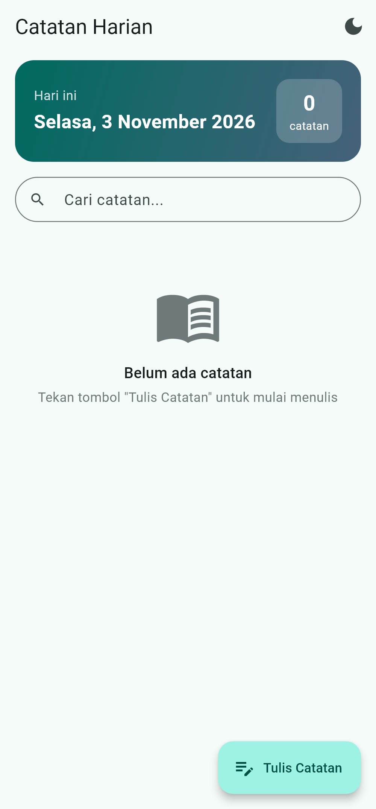
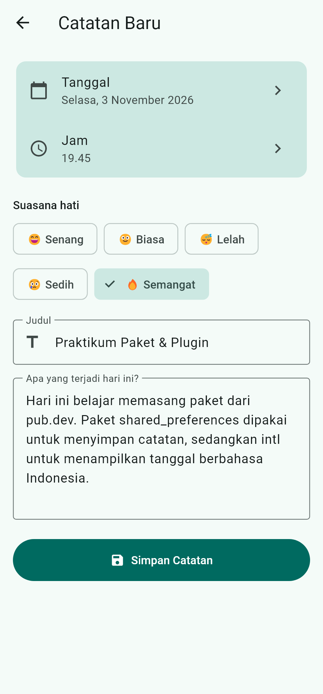
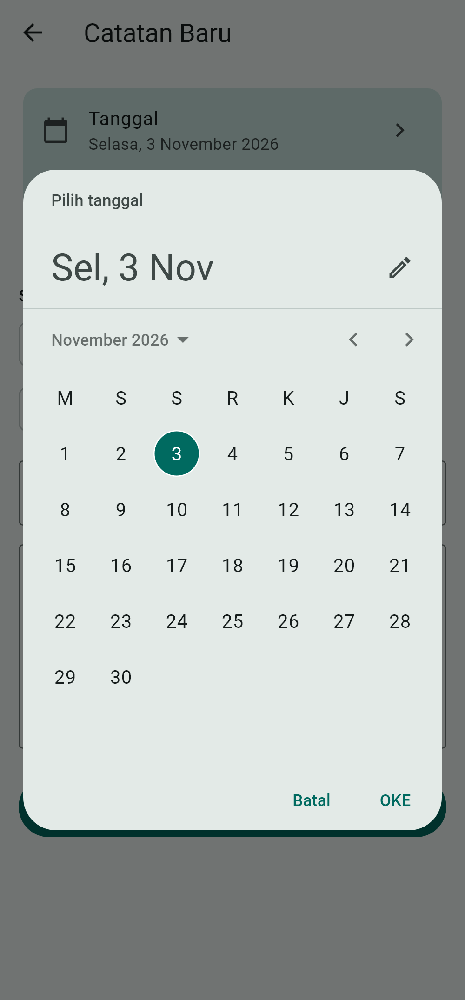
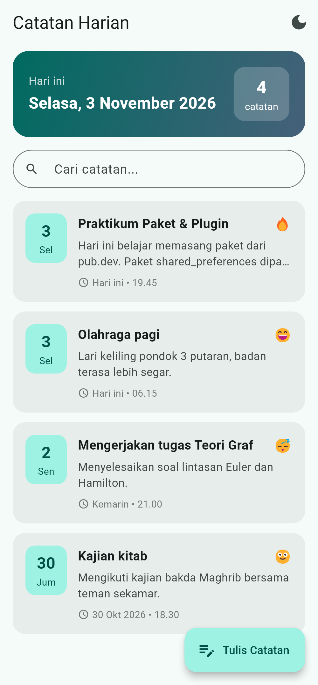
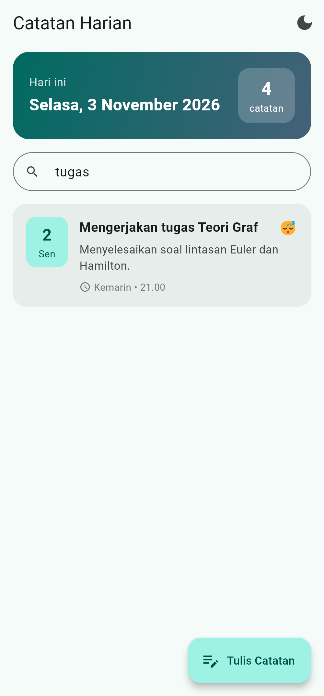
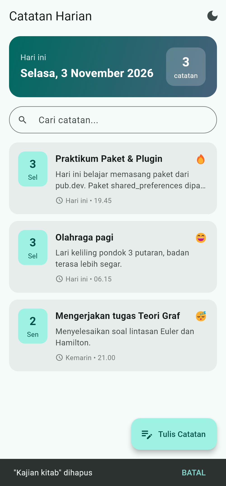
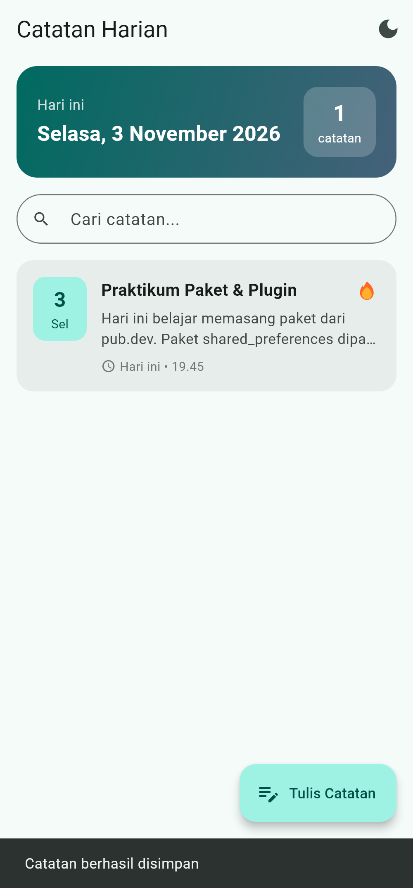
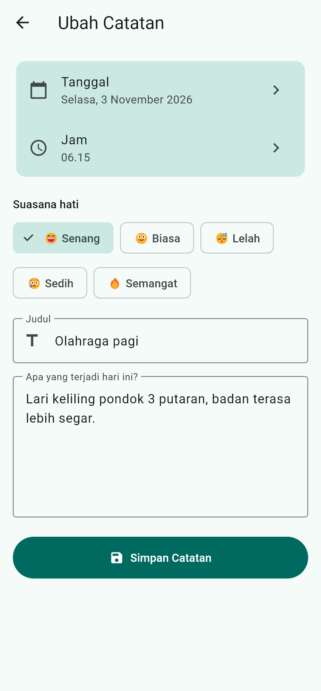
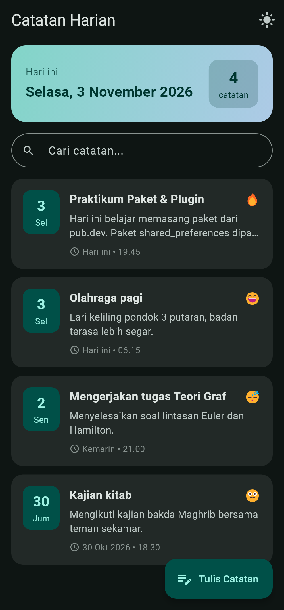

# Catatan Harian

Aplikasi Flutter sederhana untuk menulis catatan harian. Dibuat untuk tugas
**Mobile Programming Bab 8 – Menggunakan Paket dan Plugin pada Flutter** (Sesi 10).

- **Nama:** Ahmad Mofidur Robbiyal Aqla
- **NIM:** 2495114006
- **Kelas:** 5 - A

## Paket yang digunakan

| Paket | Versi | Fungsi di aplikasi |
|-------|-------|--------------------|
| [shared_preferences](https://pub.dev/packages/shared_preferences) | ^2.5.6 | Menyimpan daftar catatan (format JSON) dan pengaturan tema gelap di penyimpanan lokal perangkat, sehingga data tetap ada saat aplikasi ditutup. |
| [intl](https://pub.dev/packages/intl) | ^0.20.3 | Memformat tanggal & jam berbahasa Indonesia, misalnya `Selasa, 3 November 2026`, `3 Nov 2026`, dan `19.45`. |
| flutter_localizations (SDK) | – | Membuat date picker dan time picker tampil dalam bahasa Indonesia. |

## Fitur

- Menampilkan tanggal hari ini dan jumlah catatan.
- Menambah catatan (tanggal, jam, suasana hati, judul, isi) dengan validasi form.
- Mengubah catatan dengan mengetuk kartunya.
- Menghapus catatan dengan menggeser kartu ke kiri, bisa dibatalkan.
- Mencari catatan berdasarkan judul atau isi.
- Label waktu relatif: *Hari ini*, *Kemarin*, atau tanggal singkat.
- Tema terang / gelap yang pilihannya ikut tersimpan.

## Struktur folder

```
lib/
├── main.dart                     # inisialisasi intl + tema + lokal Indonesia
├── models/catatan.dart           # model data + konversi JSON
├── services/catatan_storage.dart # baca/tulis shared_preferences
├── utils/format_tanggal.dart     # format tanggal dengan intl
├── pages/
│   ├── beranda_page.dart         # daftar, cari, hapus catatan
│   └── form_catatan_page.dart    # tambah / ubah catatan
└── widgets/kartu_catatan.dart    # tampilan satu catatan
test/widget_test.dart             # 8 pengujian unit & widget
```

## Menjalankan

```bash
flutter pub get
flutter run
flutter test
```

## Tampilan

| Beranda kosong | Form catatan | Pilih tanggal |
|---|---|---|
|  |  |  |

| Daftar catatan | Pencarian | Hapus + batal |
|---|---|---|
|  |  |  |

| Catatan tersimpan | Ubah catatan | Tema gelap |
|---|---|---|
|  |  |  |
